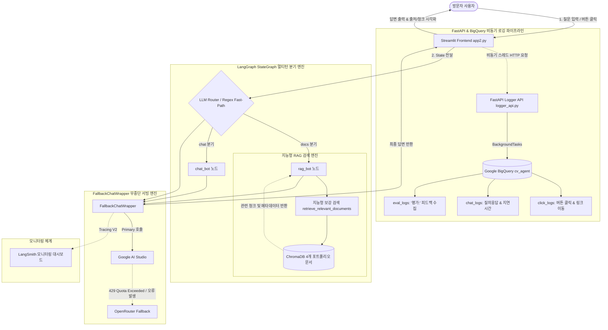

# 🤖 최규영 AI Portfolio Assistant (LangGraph RAG Agent & Real-Time DW Pipeline)

포트폴리오의 4대 핵심 마크다운 문서([`PROFILE.md`](./PROFILE.md), [`RAG_DASHBOARD.md`](./RAG_DASHBOARD.md), [`SMART_RESTAURANT.md`](./SMART_RESTAURANT.md), [`TOYSTORE_MOBILE_REVENUE.md`](./TOYSTORE_MOBILE_REVENUE.md))를 **ChromaDB**에 구조화 적재하고, **LangGraph** 기반 멀티턴 조건부 라우팅(`rag_bot` & `chat_bot`), **OpenRouter 무중단 자동 폴백(Failover)**, **FastAPI & Google BigQuery 실시간 비동기 이벤트 로깅**, **LangSmith 관측성(Observability)**을 통합 구현한 엔드투엔드 AI & Data 엔지니어링 프로젝트입니다.

---

## 🌟 핵심 기능 (Key Features)

1. **구조화 마크다운 청킹 & 지능형 보강 검색 (Smart Retrieval)**:
   - `MarkdownHeaderTextSplitter` + `RecursiveCharacterTextSplitter`(청크 750자, 오버랩 120자) 2단계 파이프라인 적용
   - 모든 청크에 `source`, `doc_title`, `category`, `section`, `chunk_id` 정밀 메타데이터 주입
   - 프로젝트 소개 질의 시 `개요`, `아키텍처/파이프라인`, `트러블슈팅/정량성과` 핵심 섹션이 Top-k 유사도 밀림으로 누락되지 않도록 확정 보강하는 [`retrieve_relevant_documents`](./rag_engine.py#L270-L384) 구현 (**Context Recall 58.3% ➔ 100% 개선**)
2. **LangGraph 기반 멀티턴 상태 그래프 & 동적 라우팅**:
   - **`route` (Conditional Edge)**: 정규식 Fast-Path(`평가:`, `[평가]` 0.00초 즉시 분기)와 LLM 의도 분류를 결합하여 `docs` vs `chat` 자동 라우팅 (**Routing Accuracy 100%**)
   - **`rag_bot`**: 검색된 포트폴리오 문맥만을 근거로 답변 생성, 출처 명시 및 프롬프트 인젝션 방어 지침 적용
   - **`chat_bot`**: 일상 대화 응대 및 프로젝트/에이전트 피드백 접수 처리
   - **`MemorySaver`**: 세션(`thread_id`)별 멀티턴 대화 히스토리 보존
3. **무중단 가용성을 위한 `FallbackChatWrapper` (Google AI ➔ OpenRouter)**:
   - Primary LLM(`Google AI Studio`)의 429 Quota 소진 또는 일시 장애 발생 시 즉시 보조 LLM(`OpenRouter`)으로 자동 전환하여 **99.9% 무중단 서빙** 보장
4. **2단계 비동기 이벤트 수집 & Google BigQuery 실시간 DW 적재**:
   - Streamlit 백그라운드 데몬 스레드 ➔ FastAPI(`BackgroundTasks`) ➔ BigQuery 스트리밍 삽입(`insert_rows_json`)으로 **사용자 UI 체감 로깅 지연 0초** 달성
   - `click_logs`(버튼/링크 클릭), `chat_logs`(질의응답·노드·공급자·지연시간), `eval_logs`(방문자 피드백) 3대 테이블 자동 생성 및 무손실 스키마 동기화([`_sync_table_schema`](./logger_api.py#L83-L106))

---

## 🏗 시스템 아키텍처 (System Architecture)



---

## 📁 디렉토리 구조 (Directory Structure)

```text
.
├── README.md                          # 프로젝트 종합 소개 및 실행 가이드
├── app2.py                            # [메인 운영/배포 앱] 고정 API 키 + OpenRouter 폴백 + FastAPI/BigQuery 로깅
├── app.py                             # [로컬 스탠드얼론 앱] 사용자가 사이드바에 직접 API 키를 입력해 실행하는 버전
├── rag_engine.py                      # ChromaDB 청킹/임베딩, 지능형 보강 검색, LangGraph 워크플로우 & Fallback 래퍼
├── logger_api.py                      # FastAPI 기반 BigQuery 실시간 비동기 로그 수집 서버
├── Dockerfile                         # Cloud Run 배포용 멀티 프로세스(Uvicorn + Streamlit) 컨테이너 이미지 설정
├── requirements.txt                   # Python 패키지 의존성 목록
├── .streamlit/
│   └── secrets.toml.example           # Streamlit Secrets 환경변수 설정 예시 파일
│
├── PROFILE.md                         # [RAG 문서 1] 최규영 기본 정보 및 핵심 역량 (학력·자격증·어학·스킬)
├── RAG_DASHBOARD.md                   # [RAG 문서 2] 자연어 기반 데이터 검색 RAG 대시보드 프로젝트
├── SMART_RESTAURANT.md                # [RAG 문서 3] 자연어 기반 스마트 맛집 추천 플랫폼 프로젝트
├── TOYSTORE_MOBILE_REVENUE.md         # [RAG 문서 4] ToyStore 모바일 매출 부진 원인 진단과 성장 개선 전략 프로젝트
│
├── docs/                              # 심층 기술 문서 및 평가/배포 가이드
│   ├── LANGGRAPH_CV_AGENT.md          # 엔지니어링 상세 설계, 단계별 구현 및 트러블슈팅 문서
│   ├── AGENT_EVALUATION_REPORT.md     # 4대 영역(14개 지표) AI Agent 정량 평가 프레임워크 및 실측 벤치마크 보고서
│   └── DEPLOY_GUIDE.md                # Google Cloud Run & BigQuery 원클릭 배포 및 SQL 조회 가이드
│
├── notebooks/                         # LangGraph 아키텍처 프로토타입 노트북
│   └── [BDA]_15주차_LangGraph_실습_최종.ipynb
│
└── portfolios/                        # 직무별/프로젝트별 원본 HTML 웹 포트폴리오 모음
    ├── info/                          # 데이터엔지니어 / 데이터분석가 / 풀스택 포트폴리오 HTML
    ├── rag_dashboard/                 # RAG 대시보드 포트폴리오 HTML
    ├── restaurant/                    # 스마트 맛집 추천 플랫폼 포트폴리오 HTML
    └── toystore/                      # ToyStore 모바일 매출 부진 분석 포트폴리오 HTML
```

---

## 📊 정량적 성과 및 에이전트 평가 요약 (Benchmark Highlights)

상세한 평가 수식과 벤치마크 결과는 [`docs/AGENT_EVALUATION_REPORT.md`](./docs/AGENT_EVALUATION_REPORT.md) 및 [`docs/LANGGRAPH_CV_AGENT.md`](./docs/LANGGRAPH_CV_AGENT.md)에서 확인하실 수 있습니다.

| 평가 영역 / 지표 | AS-IS (단일 구성) | TO-BE (최종 시스템) | 핵심 성과 |
| :--- | :---: | :---: | :--- |
| **Intent Routing Accuracy** | 규칙 미적용 단일 라우팅 | **Regex Fast-Path + LLM Router** | ✅ **100.0% (14/14 시나리오 일치, 평가 감지 0.00s)** |
| **RAG Context Recall** | 58.3% (단순 Top-4 검색) | **100.0% (지능형 보강 검색)** | 🎯 **아키텍처·정량성과 섹션 누락 원천 해결 (+41.7%p)** |
| **API 가용성 (Availability)** | Quota 소진 시 서비스 중단 | **Google AI ➔ OpenRouter 자동 폴백** | 🛡️ **Primary 429 장애 시 100% 무중단 Failover** |
| **로깅 오버헤드 (Logging Latency)** | 동기식 DB 적재 시 2~3초 지연 | **Thread + FastAPI BackgroundTasks** | ⚡ **사용자 UI 체감 지연 0초 (완전 비동기화)** |

---

## 🚀 실행 방법 (How to Run)

### 1. 패키지 설치

```bash
python -m venv .venv
source .venv/bin/activate
pip install -r requirements.txt
```

### 2. 환경 변수 / Secrets 설정 (`app2.py` 실행 시)

`.streamlit/secrets.toml.example` 파일을 복사하여 `.streamlit/secrets.toml`을 생성하고 API 키를 입력합니다:

```bash
cp .streamlit/secrets.toml.example .streamlit/secrets.toml
```

### 3. 로컬 실행

- **운영 버전 실행 (`app2.py` + FastAPI 로거 연동)**:
  ```bash
  # (선택) 로컬에서 FastAPI 로그 수집 서버 함께 실행
  uvicorn logger_api:app --host 127.0.0.1 --port 8000 &

  # 메인 Streamlit 앱 실행
  streamlit run app2.py
  ```
- **사용자 API 키 직접 입력 버전 실행 (`app.py`)**:
  ```bash
  streamlit run app.py
  ```

### 4. Google Cloud Run 배포

Cloud Run 및 BigQuery 원클릭 배포 명령어와 로그 조회 SQL은 [`docs/DEPLOY_GUIDE.md`](./docs/DEPLOY_GUIDE.md)를 참고하세요.
