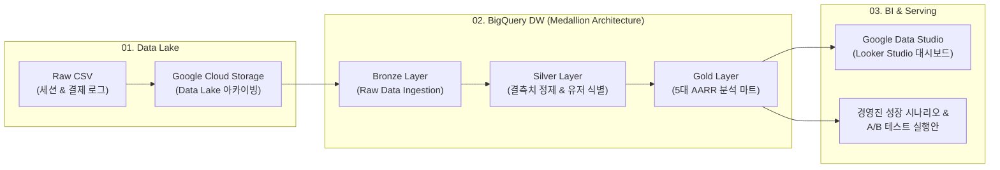

# ToyStore E-Commerce 모바일 매출 부진 원인 진단과 성장 개선 전략 (Mobile Revenue Growth Strategy)

Kaggle Maven Fuzzy Factory Toy Store E-Commerce 로그 데이터를 기반으로 Device(Desktop vs Mobile)별 매출 격차를 정밀 진단하고, **AARR(Acquisition · Activation · Retention · Revenue)** 프레임워크를 통해 핵심 병목을 규명한 후 데이터 마트 구축 및 실행 가능한 성장 시나리오를 도출한 **데이터 엔지니어링 & 비즈니스 인텔리전스(BI)** 분석 프로젝트입니다.

---

## 📌 1. 프로젝트 개요 (Overview)

- **프로젝트명**: Mobile 매출 부진 원인 진단과 성장 개선 전략 (ToyStore 모바일 매출 부진 분석)
- **개발 기간**: 2026.07 – 2026.08 (약 1개월)
- **수행 형태**: 4인 팀 프로젝트
- **담당 역할**: Data Analyst / Data Engineer (GCS-BigQuery ETL 파이프라인 구축, AARR 기반 5대 분석 마트 설계, 코호트/Cross-device 분석, Looker Studio 인터랙티브 대시보드 구축 및 성장 시나리오 수립)
- **대시보드 링크**: [Google Data Studio (Looker Studio) 대시보드 바로가기](https://datastudio.google.com/u/1/reporting/ca82b5d2-f174-4717-ba68-aecf946f763c/page/BI27F)
- **활용 데이터**: Kaggle Maven Fuzzy Factory Toy Store E-Commerce 로그 데이터셋 (웹 방문 세션, 페이지뷰, 주문 및 결제 트랜잭션 로그)
- **프로젝트 목표**:
  - Desktop 대비 현저히 낮은 Mobile 매출 기여도의 근본 원인을 비즈니스 퍼널 전반에서 다각도로 분해
  - 막연한 '매출 증대'가 아닌 정량적 벤치마크(Criteo Q4 2014) 기반의 명확한 목표 점유율(25.0%) 설정
  - 불필요한 영역의 예산 낭비를 방지하고, 가장 임팩트가 큰 핵심 레버(Acquisition & Activation)에 자원을 집중시키는 데이터 기반 전략 도출

---

## 🛠 2. 기술 스택 (Tech Stack)

| 영역 | 기술 스택 | 설명 |
| :--- | :--- | :--- |
| **Language & Query** | `Python`, `SQL` | 데이터 전처리, 통계 검정, BigQuery 분석 쿼리 작성 |
| **Cloud Storage & DW** | `Google Cloud Storage (GCS)`<br>`Google BigQuery` | 대용량 Raw CSV 데이터 아카이빙 (Data Lake)<br>Bronze → Silver → Gold 레이어드 아키텍처 및 5대 분석 마트 적재 |
| **BI & Visualization** | `Google Data Studio (Looker Studio)`<br>`Canvas HTML Charts` | 경영진 및 이해관계자 의사결정 지원용 반응형 대시보드 배포<br>분기별 매출 추이 및 퍼널 인터랙티브 차트 구현 |
| **Methodology** | `AARR Framework`<br>`Funnel Analysis`<br>`Cohort & Cross-device Analysis`<br>`A/B Testing Hypothesis` | 총매출 분해 및 디바이스별 상대 효율 측정<br>6단계 구매 전환 퍼널 이탈 구간 진단<br>D7/D30/D90 리텐션 및 디바이스 간 전환 추적<br>UX 개선 가설 및 실험 레버 도출 |

---

## 🔍 3. 문제 정의 및 목표 설정 (Problem Definition & Target)

### 🚨 현상 진단 (2014 Q4 기준)
- **극심한 디바이스별 매출 격차**:
  - **Desktop Revenue**: **$326,855** (전체 매출의 86.72% 견인)
  - **Mobile Revenue**: **$50,037** (전체 매출의 **13.28%**에 정체)
  - Mobile 매출은 Desktop 대비 불과 **15.3%** 수준에 불과
- **구조적 정체 (2012 Q2 ~ 2014 Q4 추이)**:
  - 데스크톱 매출이 분기마다 가파르게 성장하는 동안, 모바일 점유율은 8%~17% 박스권에 갇혀 구조적 성장이 정체됨

### 🎯 목표 시나리오 (North Star Goal)
- **벤치마크 기준**: 글로벌 E-Commerce 리포트(Criteo Q4 2014 E-Commerce Benchmark) 기준 모바일 점유율 수준을 벤치마크로 설정
- **정량적 목표**:
  - 모바일 매출 점유율: **13.28% → 25.00%** (+11.72%p)
  - 모바일 분기 매출: **$50,037 → $108,952** (추가 확보 필요 매출: **+$58,915**)

```
[현재 실적] Mobile Share 13.28% ($50,037)
                      ↓↓  (목표 갭: +$58,915)
[목표 달성] Mobile Share 25.00% ($108,952)
```

---

## 🏗 4. 데이터 파이프라인 및 BigQuery 5대 분석 마트

GCS Data Lake에서 BigQuery DW를 거쳐 Looker Studio 대시보드로 이어지는 재현성 높은 엔드투엔드 파이프라인을 구축했습니다.



### 📊 BigQuery 5대 분석 마트 (Gold Layer)
1. **MART 01. Session CVR**: 디바이스별 세션 수, 주문 수, 세션 전환율(CVR) 시계열 추이
2. **MART 02. Funnel**: Landing → Products → Detail → Cart → Shipping → Billing → Order 단계별 이탈률 및 전환율
3. **MART 03. Retention - User**: 신규(First) vs 재방문(Repeat) 세션 분해 및 코호트 재방문율(D7, D30, D90)
4. **MART 04. Retention - Device**: Cross-device 후속 결제 기기 추적 (모바일 유입 후 데스크톱 최종 결제 전환율)
5. **MART 05. Revenue**: 디바이스별 분기 총매출, 주문 건수, 평균 주문 가치(AOV)

---

## 📈 5. AARR 프레임워크 총매출 분해 및 진단 (Diagnosis)

매출 부진의 원인을 막연히 추측하지 않고, 매출 방정식을 4가지 핵심 요인으로 수학적으로 분해하여 Desktop(=100%) 대비 Mobile의 상대적 효율을 측정했습니다.

$$\text{Total Revenue} = \text{First Sessions (유입)} \times \text{Session CVR (전환)} \times \text{Repeat Expansion (재방문)} \times \text{AOV (객단가)}$$

```
┌─────────────────┬───────────────────┬───────────────────┬─────────────────────────────────┐
│ AARR 단계       │ Desktop 실적      │ Mobile 실적       │ Desktop 대비 Mobile 효율 (진단) │
├─────────────────┼───────────────────┼───────────────────┼─────────────────────────────────┤
│ A · Acquisition │ 44,954 건         │ 18,018 건         │ 🔴 40.1%  (유입 규모 심각한 부족)│
│ A · Activation  │ 9.60 %            │ 3.42 %            │ 🔴 35.6%  (가장 치명적인 핵심병목) │
│ R · Retention   │ 1.19 ×            │ 1.28 ×            │ 🟢 107.5% (오히려 우수, 정상)     │
│ R · Revenue     │ $63.81            │ $63.66            │ 🟢 99.8%  (동일 수준, 정상)       │
└─────────────────┴───────────────────┴───────────────────┴─────────────────────────────────┘
```

### 1) A · Acquisition (신규 유입 규모) : 🔴 핵심 병목 1
- 모바일 신규 유입은 데스크톱의 **40.1%**에 불과 (18,018건 vs 44,954건).
- 채널별 분석 결과:
  - `Paid GSearch Nonbrand`: 13,111건 (CVR 3.52%) → 유입 규모 확대의 핵심 축
  - `Paid BSearch Nonbrand`: 1,259건 (CVR 3.10%) → 데스크톱 대비 유입 격차가 가장 심각한 채널 (공격적 예산 확대 필요)

### 2) A · Activation (구매 전환율 CVR) : 🔴 가장 치명적인 핵심 병목 2
- 모바일 CVR은 **3.42%**로, 데스크톱(9.60%)의 **35.6% 수준**에 그침.
- 세션 유입 후 결제 완료까지 이어지는 사용자 경험 상에 심각한 병목이 존재함을 확인.

### 3) R · Retention (재방문 배수) : 🟢 정상 (우수)
- 재방문 확장 배수는 모바일이 **1.28배**로 데스크톱(1.19배)보다 높음 (107.5% 효율).
- 코호트 리텐션 지표:
  - D7 재방문율: Mobile **3.82%** vs Desktop 3.41%
  - D30 재방문율: Mobile **8.45%** vs Desktop 7.92%
  - D90 재방문율: Mobile **13.40%** vs Desktop 12.81%
- **Cross-device 인사이트**: 모바일 유입 유저의 D90 후속 구매 중 **85.16%**, 재구매의 **89.36%**가 모바일이 아닌 **데스크톱으로 디바이스를 변경하여 결제**하는 패턴 확인 (모바일 탐색 → 데스크톱 결제).

### 4) R · Revenue (평균 주문 가치 AOV) : 🟢 정상
- 모바일 AOV는 **$63.66**, 데스크톱은 **$63.81**로 **99.8% 동일**.
- 모바일 유저라고 해서 더 저렴한 상품을 사거나 적게 담지 않음.

> **💡 전략적 의사결정**:
> 이미 우수한 성과를 내고 있는 Retention(재방문 프로모션)이나 Revenue(묶음 할인/객단가 인상)에 불필요한 마케팅 리소스를 낭비하지 않고, **Acquisition(유입)**과 **Activation(전환율)** 2대 레버에 집중하기로 결정.

---

## 🛒 6. 구매 전환 퍼널 심층 분석 (Activation Funnel 6단계)

모바일 세션의 구매 전환 단계별 이탈률을 전수 추적하여 최우선 최적화 대상 구간을 도출했습니다.

```
[Landing] ──50.06%──▶ [Products] ──69.95%──▶ [Detail] ──42.64%──▶ [Cart] ──59.26%──▶ [Shipping] ──70.13%──▶ [Billing] ──54.97%──▶ [Order]
```

### 🚩 2대 최우선 개선 구간
1. **PRIORITY 01 : Landing → Products (절대 이탈 규모 최대 구간)**
   - 통과율: **50.06%**
   - **문제점**: 랜딩 페이지에 도달한 후 상품 목록조차 보지 못하고 이탈하는 절대 볼륨이 **66,731건**에 달함.
   - **개선 방안**: 모바일 첫 화면 로딩 속도 최적화, 메인 배너 및 상단 카테고리 내비게이션 UX 단순화
   - **목표치**: 통과율 50.06% → **54.71%**

2. **PRIORITY 02 : Products → Detail (기기 간 전환율 격차 최대 구간)**
   - 통과율: **69.95%** (데스크톱은 **86.30%**, 격차 **16.35%p**)
   - **문제점**: 상품 목록을 탐색하면서도 상세 페이지로 진입하지 못하는 비율이 데스크톱 대비 비정상적으로 높음.
   - **개선 방안**: 모바일 화면에 최적화된 상품 카드 썸네일 해상도 개선, 가격/평점 가독성 강화, 상세 이동 CTA 버튼 가시성 확보
   - **목표치**: 통과율 69.95% → **82.33%**

---

## 🎯 7. 목표 달성 시나리오 & 3단계 실행 로드맵 (Growth Scenario & Roadmap)

### 📈 2대 레버 통합 시뮬레이션
Retention(1.28×)과 AOV($63.66)는 현재의 우수한 수준을 유지한다는 전제하에, 2대 핵심 레버를 복합 개선:

| 레버 | AS-IS | 목표치 (TO-BE) | 개선 배수 |
| :--- | :---: | :---: | :---: |
| **LEVER 1 · Acquisition** (First Session) | 18,018건 | **25,638건** (점유율 28.6% → 36.3%) | **$\times 1.423$** |
| **LEVER 2 · Activation** (Session CVR) | 3.42% | **5.23%** (상세 진입 69.9% → 82.3%) | **$\times 1.530$** |

- **시뮬레이션 최종 결과**:
  - 모바일 매출: **$50,037 → $108,952** (증분 매출 **+$58,915** 전액 확보)
  - 모바일 매출 점유율: **13.28% → 25.00%** 달성

---

### 🗺 3단계 실행 로드맵 (Execution Roadmap)

```
[STAGE 01] Paid Search 모바일 광고 확대  ──▶  [STAGE 02] 모바일 랜딩 로딩속도/UX 개선  ──▶  [STAGE 03] 상품 목록 CTA 강화 A/B Test
  (GSearch 18.2k / BSearch 3.7k 증액)             (Landing → Products: 50.1% → 54.7%)           (Products → Detail: 69.9% → 82.3%)
```

1. **STAGE 01 · Paid Expansion (유료 검색광고 모바일 유입 확대)**:
   - CVR이 검증된 `Paid GSearch Nonbrand` 예산 증액 (13.1k → 18.2k 세션)
   - 상대적으로 유입이 저조한 `Paid BSearch Nonbrand` 입찰 전략 수정 (1.2k → 3.7k 세션)
2. **STAGE 02 · Landing Optimize (모바일 랜딩 반응성 개선)**:
   - 모바일 네트워크 환경에 맞춘 웹 폰트/이미지 경량화로 초기 렌더링 지연 단축
   - 직관적인 상품 카테고리 퀵 내비게이션 배치
3. **STAGE 03 · Detail Entry (상품 카드 CTA 강화 A/B Testing)**:
   - 모바일 상품 그리드 뷰에서 썸네일 크기, 핵심 리뷰 태그, "자세히 보기" CTA 버튼 가시성을 대조군(A)과 실험군(B)으로 A/B 테스트 진행

---

## 💡 8. 분석 성과 및 회고 (Retrospective & Limitations)

### 🏆 프로젝트 핵심 성과 (Strengths)
1. **AARR 프레임워크 기반의 '평균의 함정' 탈피**:
   - 단순히 "모바일 매출이 낮다"는 현상에서 벗어나, 리텐션(107.5%)과 객단가(99.8%)가 이미 정상임을 입증함으로써 불필요한 예산 낭비를 차단하고 유입·전환 2대 영역에 리소스를 집중시킴.
2. **Cross-device 유저 행동 발견**:
   - 모바일 유저의 상당수(85% 이상)가 결제 단계에서 데스크톱으로 이탈하는 현상을 규명하여, 모바일 환경의 결제 편의성 개선 및 옴니채널 관점의 분석 가치 증명.
3. **재현성 높은 클라우드 인프라 & 대시보드 구축**:
   - GCS → BigQuery 레이어드 아키텍처로 5대 분석 마트를 구축하여 쿼리 재현성을 보장하고 Looker Studio로 경영진 의사결정 인터페이스 완성.

### ⚠️ 한계점 및 향후 과제 (Limitations)
1. **실제 UI/UX 디자인 데이터 부재**:
   - 로그 데이터만으로 분석을 진행하여 실제 당시 모바일 사이트의 세부 UI/UX 화면을 직접 확인하지 못한 상태에서의 가설 설정 한계 존재.
2. **마케팅 비용(Cost) 데이터 부재**:
   - 광고비 데이터가 누락되어 있어, 유료 유입 확대 시 CAC(고객 획득 비용)와 ROAS(광고비 대비 매출액)를 연계한 정밀 수익성 시뮬레이션 모델링으로의 고도화 과제 존재.


