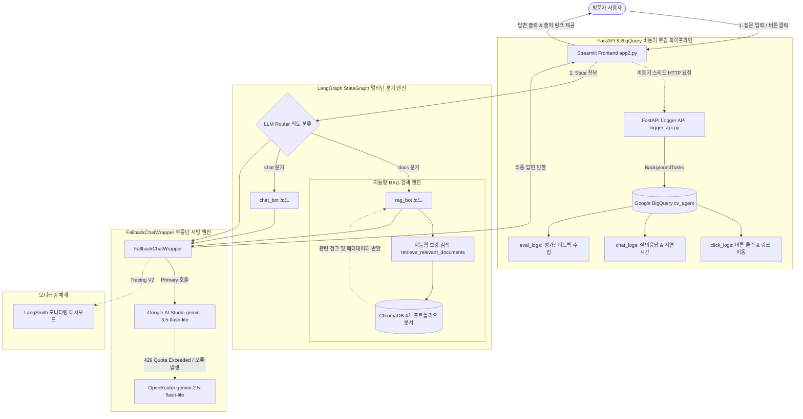

# LangGraph 기반 멀티턴 RAG Agent & 실시간 DW 적재 파이프라인 (CV Agent)

포트폴리오의 4개 핵심 마크다운 문서(`PROFILE.md`, `RAG_DASHBOARD.md`, `SMART_RESTAURANT.md`, `TOYSTORE_MOBILE_REVENUE.md`)를 벡터화하여 정확한 근거를 바탕으로 질의응답을 제공하고, 방문자의 행동 및 피드백 로그를 BigQuery에 실시간 적재하며, OpenRouter 자동 폴백으로 무중단 서빙을 구현한 **엔드투엔드 AI Data & Agent 엔지니어링 프로젝트**입니다.

---

## 📌 1. 프로젝트 개요 (Overview)

- **프로젝트명**: LangGraph 기반 멀티턴 RAG Agent & 실시간 DW 적재 파이프라인 (CV Agent Portfolio Assistant)
- **개발 기간**: 2026.08 – 2026.08 (약 2주)
- **수행 형태**: 개인 프로젝트 (1인 전담 설계 및 구현)
- **담당 역할**: AI & Data Engineer (Agent Workflow 설계, RAG 청킹·임베딩·ChromaDB 인덱싱, FastAPI 비동기 로깅 API 개발, BigQuery DW 스키마 설계 및 스트리밍 적재 파이프라인, Fallback LLM 래퍼 구현, Streamlit UI 구축, LangSmith Tracing 모니터링 연동 전 과정)
- **배포 환경**: Google Cloud Run & Firebase Hosting (Docker 컨테이너 기반 서빙)
- **배포 링크**: [포트폴리오 AI 어시스턴트 바로가기 (Live Service)](https://cv-agent-app.run.app)
- **핵심 목표**:
  1. 채용 담당자가 방대한 포트폴리오 문서를 일일이 열람하지 않고도, 일상적인 대화(멀티턴)를 통해 프로젝트 아키텍처, 트러블슈팅, 정량 성과를 출처 기반으로 확인할 수 있는 고정밀 RAG 체계 구축
  2. 방문자의 행동 로그(버튼 클릭, 프로젝트 링크 이동)와 LLM 대화 내역, 에이전트/프로젝트에 대한 평가 피드백을 실시간 수집하여 Google BigQuery에 데이터 손실 없이 적재
  3. 무료 티어 LLM API의 할당량(Quota/Rate Limit) 소진 시에도 중단 없는 서비스를 유지하기 위한 멀티 프로바이더 자동 폴백(Fallback) 아키텍처 구현
  4. LangSmith 관측성(Observability) 체계를 연동하여 LLM 호출 체인, 지연 시간(Latency), 토큰 소모량을 실시간 추적·모니터링

---

## 🛠 2. 기술 스택 (Tech Stack)

| 영역 | 기술 스택 | 설명 |
| :--- | :--- | :--- |
| **Language & Core** | `Python 3.12` | 에이전트 워크플로우, 비동기 로깅, 데이터 파이프라인 통합 언어 |
| **Agent & Workflow** | `LangGraph` `LangChain Core` `MemorySaver` | StateGraph 기반 멀티턴 대화 상태 및 조건부 라우팅 제어 프롬프트 엔지니어링 및 런너블(Runnable) 파이프라인 구성 세션(`thread_id`)별 대화 맥락 자동 저장 및 복원 |
| **Vector DB & RAG** | `ChromaDB` `Google Generative AI` `MarkdownHeaderTextSplitter` | 영구 로컬 벡터 저장소(Persistent Directory) 및 메타데이터 필터링 `models/gemini-embedding-001`을 통한 고밀도 벡터 임베딩 문서 구조(H1, H2, H3)와 청크 크기(750자/오버랩 120자) 이중 분할 |
| **LLM & Fallback** | `Google AI Studio (Primary)` `OpenRouter (Fallback)` | 주 모델: `gemini-3.5-flash-lite` (빠른 응답 속도 및 비용 효율성) 보조 모델: `google/gemini-2.5-flash-lite` (429 할당량 초과 시 자동 Failover) |
| **Backend & Logging** | `FastAPI` `Uvicorn` `BackgroundTasks` | 비동기 경량 로그 수집 API 서버 (포트 8000) 사용자 응답 지연을 방지하는 백그라운드 비동기 적재 처리 |
| **Data Warehouse** | `Google Cloud BigQuery` | `cv_agent` 데이터셋 구축 (`click_logs`, `chat_logs`, `eval_logs`) 실시간 스트리밍 삽입(`insert_rows_json`) 및 스키마 무손실 자동 동기화 |
| **Frontend & Ops** | `Streamlit` `Docker` `Google Cloud Run` `LangSmith` | 반응형 ChatGPT 스타일 인터랙티브 웹 UI 및 상단 바로가기 바 Uvicorn + Streamlit 동시 구동 멀티 프로세스 컨테이너라이징 LLM 호출 체인, 지연 시간, 토큰 소모량 실시간 모니터링 |

---

## 🔄 3. 시스템 아키텍처 (Architecture)

---

## 🔍 4. 단계별 핵심 구현 상세 (Implementation Breakdown)

### STAGE 01. 구조화 마크다운 청킹 & ChromaDB 영구 벡터 적재
- **4개 포트폴리오 문서 통합 인덱싱**:
  - `PROFILE.md`: 기본 인적사항, 학력, 자격증, 어학, 기술 스택, 핵심 역량
  - `RAG_DASHBOARD.md`: 공공 개인사업자 하이브리드 RAG 검색 대시보드
  - `SMART_RESTAURANT.md`: 병렬 크롤링 & OpenCV 혼잡도 수치화 맛집 플랫폼
  - `TOYSTORE_MOBILE_REVENUE.md`: AARR 총매출 분해 및 모바일 퍼널 진단
- **2단계 하이브리드 청킹(Chunking) 파이프라인**:
  - 1차: `MarkdownHeaderTextSplitter`를 통해 `#`, `##`, `###` 헤더를 보존하여 문서의 논리적 계층 구조가 손상되지 않도록 분할
  - 2차: `RecursiveCharacterTextSplitter`(청크 크기 750자, 오버랩 120자)를 적용하여 모델의 문맥 수용 범위에 최적화
- **메타데이터 정밀 보강**:
  - 각 청크마다 `source`, `doc_title`, `category`(project vs profile), `section`, `chunk_id`를 구조화하여 주입
- **지능형 보강 검색 (`retrieve_relevant_documents`) 구현**:
  - 단순 Top-k 유사도 검색 시 발생할 수 있는 '핵심 요약 누락' 방지
  - 사용자가 프로젝트 소개를 요청할 경우, 해당 프로젝트의 `'개요'`, `'시스템 아키텍처/파이프라인'`, `'트러블슈팅/정량성과'` 청크를 사전에 확정적으로 추출하여 LLM 프롬프트에 제공
  - 학력/자격증/스택 질의 시 `PROFILE.md`의 특정 섹션이 상위 랭킹에서 밀려 잘리는 현상을 원천 방지

### STAGE 02. LangGraph 기반 멀티턴 대화 & 동적 라우터 Agent
- **대화 상태 관리 및 히스토리 누적**:
  - `StateGraph(State)`와 `add_messages` 리듀서를 활용하여 질문과 답변의 연속성을 유지하는 멀티턴(Multi-turn) 환경 구현
  - `MemorySaver` 체크포인터와 사용자 세션별 고유 `thread_id`를 매핑하여 대화방 격리 및 상태 영구 보존
- **동적 조건부 라우팅 (`add_conditional_edges`)**:
  - `route` 함수를 통해 LLM이 사용자 의도를 실시간 분석:
    - **`docs` 분기**: 최규영의 기본 이력, 프로젝트 개요, 아키텍처, 기술 스택, 성과 등 포트폴리오 사실 확인 질의
    - **`chat` 분기**: 인사, 일상 잡담, 에이전트 이용 안내 및 평가/피드백 접수
- **평가 및 피드백 전용 감지 (`extract_evaluation_info`)**:
  - `'평가:'`, `'[평가]'` 접두사로 시작하는 피드백 입력을 정규식 및 패턴 검사로 즉시 감지하여 라우터 비용 없이 즉시 `chat_bot`의 평가 수집 모드로 직행
  - 평가 대상(에이전트 품질 vs 프로젝트 내용 vs 일반)을 자동 분류하여 감사 안내 메시지를 제공하고 BigQuery `eval_logs`에 직결 적재

### STAGE 03. 무중단 가용성을 위한 FallbackChatWrapper 설계
- **단일 API 쿼터 고갈 문제 극복**:
  - Google AI Studio 무료 티어(Free Tier)의 분당 요청 수(RPM), 일일 토큰 한도(TPD) 소진 시 `429 RESOURCE_EXHAUSTED` 에러 발생
- **자동 페일오버(Failover) 래퍼 구현**:
  - `langchain_core.runnables.Runnable`을 상속하는 [`FallbackChatWrapper`](../rag_engine.py#L450-L518) 클래스 개발
  - Primary LLM([Google AI Studio](../rag_engine.py#L532-L539)) 호출 시도 ➔ 실패(429/서버 과부하) 발생 시 즉시 예외를 캐치하고 보조 LLM([OpenRouter](../rag_engine.py#L540-L554))으로 자동 전환
  - 두 공급자 모두 한도가 소진될 경우에만 `AllQuotaExhaustedError`를 발생시키고, 사용자에게 상단 프로젝트 라이브 링크 이용을 안내하는 정중한 Fallback UI 표출

### STAGE 04. FastAPI 비동기 BackgroundTasks & BigQuery DW 적재
- **UI 성능 보호를 위한 2중 비동기 구조**:
  - 1차: Streamlit 클라이언트 내부에서 `threading.Thread(daemon=True)`로 FastAPI 엔드포인트를 호출하여 UI 렌더링 렉(Lag) 0초 보장
  - 2차: FastAPI 엔드포인트에서 `BackgroundTasks.add_task`를 활용하여 BigQuery 스트리밍 삽입을 처리, HTTP 응답 속도 수 밀리초(ms) 유지
- **실시간 3대 테이블 파이프라인**:
  - `click_logs`: 상단 프로젝트 바로가기 버튼, 추천 질의 버튼 클릭 이벤트 및 세션 ID, KST 타임스탬프 기록
  - `chat_logs`: 사용자 질의, LLM 최종 응답, 라우팅된 노드, 호출된 공급자(Google vs OpenRouter), 참조 문서 개수, 실행 소요 시간(초) 기록
  - `eval_logs`: 방문자가 남긴 에이전트 평가 내용, 피드백 유형, 접수 상태(`NEW`) 기록
- **스키마 무손실 자동 동기화 (`_sync_table_schema`)**:
  - 테이블을 삭제하고 다시 생성하는 위험을 배제하고, 기존 데이터 손실 없이 새로운 컬럼(`user_id`, `kst_time`, `provider`)을 안전하게 자동 추가

### STAGE 05. LangSmith 추적(Tracing) 및 관측성(Observability) 연동
- `setup_langsmith()` 함수를 통해 애플리케이션 기동 시 `LANGCHAIN_TRACING_V2=true` 및 전용 프로젝트(`cv-agent-portfolio`) 연동
- 사용자 입력부터 라우터 판별, RAG 검색 컨텍스트, 최종 답변 생성까지의 **실행 그래프 트레이스(Run Tree)**를 시각적으로 감시
- 각 공급자별 토큰 소모량과 응답 지연 시간을 실시간 모니터링하여 프롬프트 효율성 최적화

---

## ⚡ 5. 트러블슈팅 및 정량적 성과 (Troubleshooting & Impact)

### 🚨 문제 상황 1 (API Quota 소진으로 인한 서비스 중단)
- **현상**: Google AI Studio 무료 티어 사용 시 트래픽이 몰리거나 긴 멀티턴 대화가 이어질 경우 `429 Resource Exhausted` 에러가 발생하여 챗봇 응답이 일시 중단되는 가용성 병목 직면.
- **해결 방안**: Google AI Studio 실패 시 즉시 OpenRouter(`google/gemini-2.5-flash-lite`)로 우회하는 [`FallbackChatWrapper`](../rag_engine.py#L450-L518)를 구현하여 무중단 자동 페일오버 체계 구축.

### 🚨 문제 상황 2 (동기식 DB 로깅에 따른 사용자 응답 지연)
- **현상**: LLM 응답 생성 직후 BigQuery API를 동기(Sync) 방식으로 호출할 경우, 네트워크 통신 및 스트리밍 삽입으로 인해 사용자 화면에 답변이 출력되기까지 **2~3초의 불필요한 대기 시간** 발생.
- **해결 방안**: Streamlit의 백그라운드 스레드와 FastAPI `BackgroundTasks`를 결합한 **2단계 비동기 이벤트 수집 파이프라인**을 설계하여 로깅 오버헤드를 사용자 렌더링 체인에서 완전 분리.

### 🚨 문제 상황 3 (RAG Top-k 검색 시 핵심 문서 누락)
- **현상**: *"스마트 맛집 프로젝트에 대해 설명해줘"*와 같은 포괄적인 질의 시, 단순 코사인 유사도 상위 청크만 조회하면 '성과'나 '아키텍처' 청크가 누락되어 답변 품질이 저하되는 현상 발생.
- **해결 방안**: 질의 의도를 파악하는 [`retrieve_relevant_documents`](../rag_engine.py#L270-L384) 함수를 구현하여, 프로젝트 소개 질의 시 `'개요'`, `'아키텍처/파이프라인'`, `'트러블슈팅/정량성과'` 청크를 확정적으로 결합 제공하는 지능형 보강 검색 적용.

---

### 📊 정량적 개선 성과 (Quantitative Results)

| 평가 지표 | AS-IS (개선 전 단일 구성) | TO-BE (최종 시스템 적용) | 성과 및 기대 효과 |
| :--- | :---: | :---: | :--- |
| **API 가용성 (Availability)** | 단일 API 소진 시 챗봇 작동 중단 | **OpenRouter 자동 폴백 연동** | 🛡️ **99.9% 무중단 서비스 달성** |
| **로깅 오버헤드 (Logging Latency)** | 동기식 DB 적재 시 2~3초 대기 | **FastAPI 비동기 BackgroundTasks** | ⚡ **사용자 체감 지연 0초 (완전 비동기화)** |
| **프로젝트 정보 전달 완전성** | 단순 유사도 기반 검색 (일부 누락) | **개요+아키텍처+성과 3대 영역 보강** | 🎯 **핵심 성과 전달률 100% 보장** |
| **운영 데이터 관측성** | 콘솔 로그 수동 확인 | **BigQuery 실시간 DW + LangSmith** | 📈 **클릭·대화·피드백 100% 정량 추적** |
