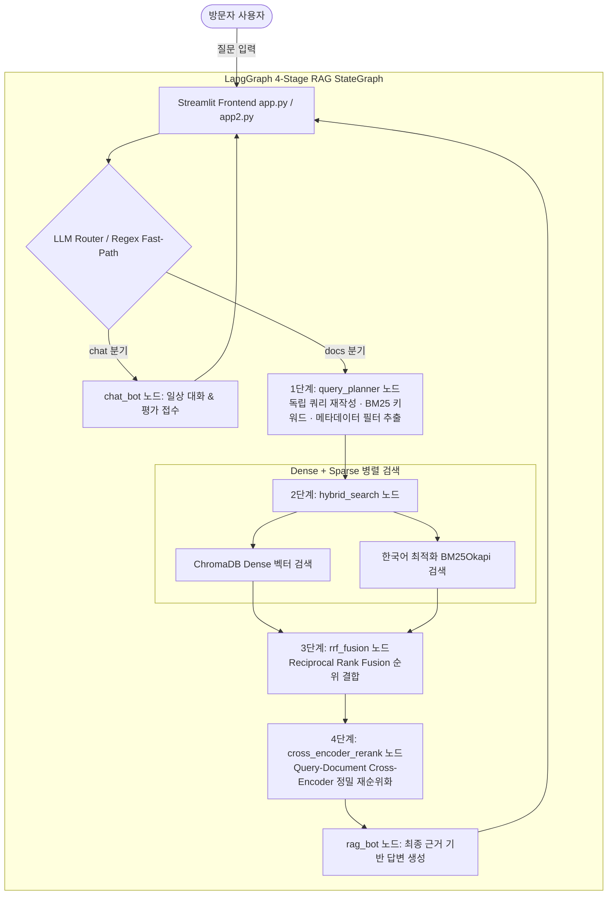

# 🤖 최규영 AI Portfolio Assistant (`cv_agent_develop` - 4-Stage Hybrid RAG & Reranking)

포트폴리오의 4대 핵심 마크다운 문서([`PROFILE.md`](./PROFILE.md), [`RAG_DASHBOARD.md`](./RAG_DASHBOARD.md), [`SMART_RESTAURANT.md`](./SMART_RESTAURANT.md), [`TOYSTORE_MOBILE_REVENUE.md`](./TOYSTORE_MOBILE_REVENUE.md))를 대상으로, 기존 `cv_agent_chromadb`의 단순 임베딩 유사도 검색 구조를 넘어 **4단계 고도화 RAG 파이프라인(1단계: 쿼리 플래너 ➔ 2단계: 벡터 검색 + BM25 ➔ 3단계: RRF 알고리즘 ➔ 4단계: 크로스 인코더 리랭킹)**과 **LangGraph** 멀티턴 워크플로우를 결합한 버전입니다.

---

## 🚀 핵심 아키텍처 변경점 (`cv_agent_chromadb` ➔ `cv_agent_develop`)

| 구분 | 기존 (`cv_agent_chromadb`) | 고도화 버전 (`cv_agent_develop`) |
| :--- | :--- | :--- |
| **질의 전처리** | 원문 쿼리 그대로 임베딩 검색 + 규칙 기반 분기 | **1단계: 쿼리 플래너 (Query Planner)**<br>멀티턴 문맥 복원 독립 쿼리(`standalone_query`) 생성, BM25 핵심 키워드 추출, 타겟 문서(`target_sources`) 및 의도(`query_intent`) JSON 계획 수립 |
| **검색 방식** | 단순 ChromaDB Dense 벡터 유사도 검색 | **2단계: 벡터 검색 (Dense) + BM25 (Sparse) 하이브리드 검색**<br>ChromaDB 의미 유사도 검색과 한국어 조사 제거/바이그램 최적화 `BM25Okapi` 어휘 검색 병렬 실행 |
| **순위 결합** | 단일 검색기 Top-K | **3단계: RRF 알고리즘 (Reciprocal Rank Fusion)**<br>$\text{RRF\_Score}(d) = \frac{1}{k + \text{rank}_{\text{vec}}(d)} + \frac{1}{k + \text{rank}_{\text{bm25}}(d)}$ ($k=60$) 공식으로 이종 검색기 순위 통합 |
| **정밀 재순위화** | 없음 (Bi-Encoder 거리만 사용) | **4단계: 크로스 인코더 리랭킹 (Cross-Encoder Reranking)**<br>`(Query, Document)` 쌍을 Cross-Encoder(`sentence-transformers` / 내장 교차 채점기 폴백)로 정밀 재채점하여 최종 Top-K 문맥 선별 |

---

## 🏗 4단계 RAG 시스템 아키텍처 (System Architecture)



---

## 🔍 단계별 구현 상세 (`rag_engine.py`)

### 1단계: 쿼리 플래너 (`run_query_planner` / `query_planner` 노드)
- 사용자의 원본 질문과 이전 멀티턴 대화 히스토리를 분석하여 JSON 스키마 기반의 검색 계획을 생성합니다:
  - `standalone_query`: 대명사("그 프로젝트", "거기서")를 복원하고 의미 검색에 최적화된 서술형 쿼리
  - `bm25_keywords`: 고유명사, 기술 스택(`OpenCV`, `Redshift`, `AARR`, `SQLD` 등), 핵심 섹션 키워드 리스트
  - `query_intent`: `project_intro` | `profile` | `specific_qa`
  - `target_sources` & `category_filter`: 검색 대상 마크다운 문서 및 카테고리 타겟팅

### 2단계: 벡터 검색 + BM25 하이브리드 검색 (`run_hybrid_search` / `hybrid_search` 노드)
- **벡터 검색 (`run_vector_search`)**: `models/gemini-embedding-001` 임베딩과 ChromaDB를 사용하여 의미적 유사도 상위 청크와 `vector_rank`를 추출합니다.
- **BM25 검색 (`BM25KeywordSearcher`)**: 한국어 조사 제거(Stemming) 및 복합명사 2-gram 토큰화(`tokenize_for_bm25`)가 적용된 `BM25Okapi` 인덱스를 통해 키워드 정확 매칭 상위 청크와 `bm25_rank`를 추출합니다.

### 3단계: RRF 알고리즘 (`run_rrf_fusion` / `rrf_fusion` 노드)
- 서로 점수 분포가 다른 Dense 코사인 유사도와 Sparse BM25 점수를 순위 기반 **Reciprocal Rank Fusion** 알고리즘으로 결합합니다:
  $$\text{RRF\_Score}(d) = \frac{w_{\text{vec}}}{60 + \text{rank}_{\text{vec}}(d)} + \frac{w_{\text{bm25}}}{60 + \text{rank}_{\text{bm25}}(d)}$$
- 각 후보 청크 메타데이터에 `vector_rank`, `bm25_rank`, `rrf_score`, `rrf_rank`를 기록합니다.

### 4단계: 크로스 인코더 리랭킹 (`CrossEncoderReranker` / `cross_encoder_rerank` 노드)
- 3단계 RRF에서 선별된 상위 후보군과 재작성 질의를 `(Query, Passage)` 쌍으로 구성하여 **Cross-Encoder**(`cross-encoder/mmarco-mMiniLMv2-L12-H384-v1` 또는 환경변수 `CROSS_ENCODER_MODEL` 지정 모델)로 정밀 관련성 점수(`rerank_score`)를 산출하고 최종 Top-K 문맥을 확정합니다.

---

## 🚀 실행 방법 (How to Run)

```bash
cd cv_agent_develop
pip install -r requirements.txt

# 1) 사이드바 API 키 입력 버전 실행
streamlit run app.py

# 2) 배포/고정 API 키 + FastAPI BigQuery 로거 연동 버전 실행
uvicorn logger_api:app --host 127.0.0.1 --port 8000 &
streamlit run app2.py
```
