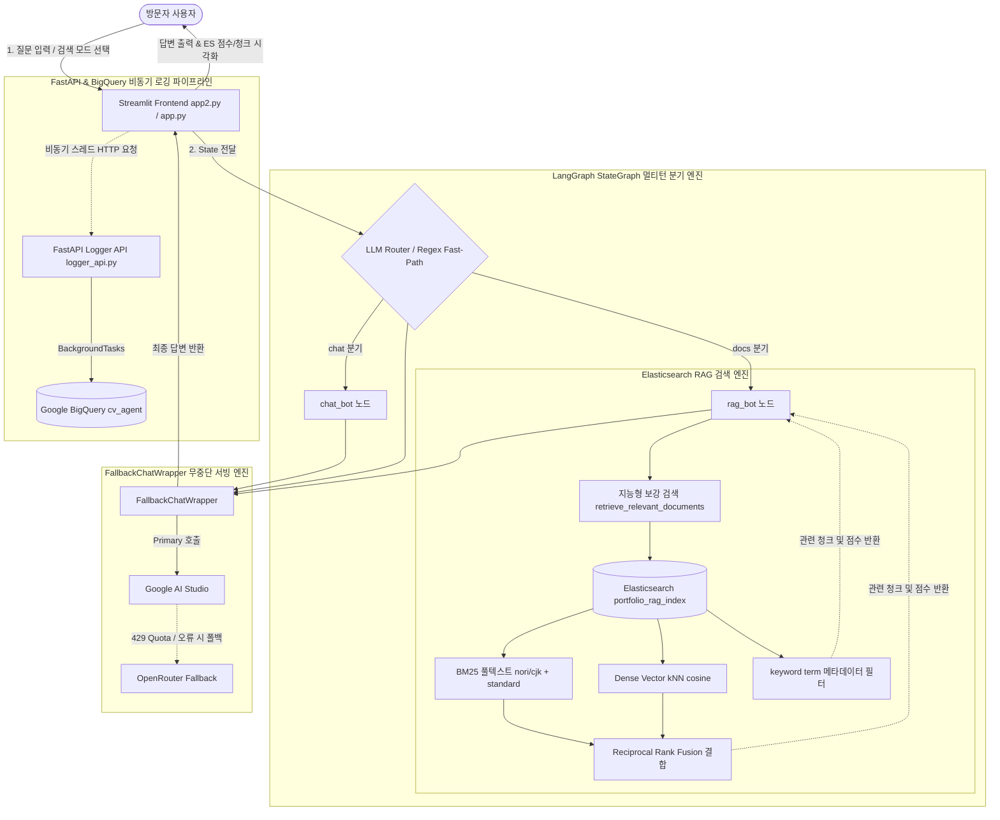

# 🔍 최규영 AI Portfolio Assistant — Elasticsearch RAG 버전 (`cv_agent_elastic`)

`cv_agent_chromadb`의 ChromaDB 기반 벡터 유사도 RAG 엔진을 **Elasticsearch 8.x 기반 검색 엔진**으로 전환·고도화한 버전입니다.  
4대 포트폴리오 마크다운 문서([`PROFILE.md`](./PROFILE.md), [`RAG_DASHBOARD.md`](./RAG_DASHBOARD.md), [`SMART_RESTAURANT.md`](./SMART_RESTAURANT.md), [`TOYSTORE_MOBILE_REVENUE.md`](./TOYSTORE_MOBILE_REVENUE.md))를 Elasticsearch 인덱스에 적재하고, **BM25 풀텍스트 검색**, **Dense Vector kNN 검색**, 그리고 **Hybrid RRF (Reciprocal Rank Fusion)** 검색을 모두 지원합니다.

---

## ⚖️ ChromaDB 버전 vs Elasticsearch 버전 비교

| 항목 | `cv_agent_chromadb` (ChromaDB) | `cv_agent_elastic` (Elasticsearch) |
| :--- | :--- | :--- |
| **검색 엔진** | 로컬 파일 기반 ChromaDB | Elasticsearch 8.x (로컬 Docker / 자체 호스팅 / Elastic Cloud) |
| **검색 방식** | Dense Vector 코사인 유사도 단일 검색 | **Hybrid (BM25 + kNN RRF)** / **BM25 풀텍스트** / **Dense Vector kNN** 선택 가능 |
| **한국어/전문용어 검색** | 임베딩 의미 유사도에 의존 | `nori`(자동 감지) 또는 내장 `cjk` + `standard` 멀티필드 분석기로 **고유명사·수치·약어(SQLD, AARR, OpenCV 등) 정밀 매칭** |
| **임베딩 API 장애 대응** | 임베딩 429 쿼터 소진 시 단순 첫 4개 청크 반환 | 임베딩 API 실패 또는 키 미등록 시에도 **Elasticsearch BM25 검색으로 자동 폴백** |
| **메타데이터 필터링** | Chroma `where` 조건 조회 | Elasticsearch `keyword` 필드 + `bool.filter` (`term`) 정렬 조회 |
| **RRF 라이선스 호환성** | 미지원 | **클라이언트 측 RRF 융합 구현**으로 무료 Elastic Basic 라이선스 포함 전 배포판 호환 |

---

## 🏗 시스템 아키텍처 (System Architecture)



---

## 📁 디렉토리 구조

```text
cv_agent_elastic/
├── README.md                          # Elasticsearch 버전 종합 가이드
├── rag_engine.py                      # Elasticsearch 인덱싱, BM25/kNN/Hybrid(RRF) 검색, LangGraph 엔진
├── app2.py                            # [운영/배포 앱] 고정 키 + OpenRouter 폴백 + ES 검색 모드 전환 + BigQuery 로깅
├── app.py                             # [로컬 스탠드얼론 앱] API 키 & ES 접속 정보 직접 입력 버전
├── logger_api.py                      # FastAPI 기반 BigQuery 실시간 비동기 로그 수집 서버
├── docker-compose.yml                 # 로컬 Elasticsearch 8.15.3 원클릭 실행 (+ 선택적 앱 컨테이너)
├── Dockerfile                         # Cloud Run 배포용 멀티 프로세스(Uvicorn + Streamlit) 이미지
├── requirements.txt                   # elasticsearch>=8.13.0 등 Python 패키지 의존성
├── .streamlit/
│   └── secrets.toml.example           # Streamlit Secrets 설정 예시 (ES + API 키)
├── PROFILE.md                         # [RAG 문서 1] 기본 정보 및 핵심 역량
├── RAG_DASHBOARD.md                   # [RAG 문서 2] RAG 대시보드 프로젝트
├── SMART_RESTAURANT.md                # [RAG 문서 3] 스마트 맛집 추천 플랫폼 프로젝트
├── TOYSTORE_MOBILE_REVENUE.md         # [RAG 문서 4] ToyStore 모바일 매출 분석 프로젝트
├── docs/
│   └── DEPLOY_GUIDE.md                # Elastic Cloud / 자체 ES + Cloud Run 배포 가이드
├── tests/
│   └── test_rag_engine.py             # 청킹, 매핑, BM25/kNN/Hybrid RRF, LangGraph 단위 테스트
├── notebooks/                         # LangGraph 프로토타입 노트북
└── portfolios/                        # 원본 HTML 포트폴리오 모음
```

---

## 🚀 실행 방법 (How to Run)

### 1. 로컬 Elasticsearch 실행 (Docker Compose)

```bash
cd cv_agent_elastic
docker compose up -d elasticsearch
```

정상 기동 확인:

```bash
curl -s http://localhost:9200
```

> **참고 (한국어 Nori 분석기 자동 감지)**:
> 기본 Elasticsearch 이미지에서는 내장 `cjk` + `standard` 멀티필드 분석기로 즉시 동작합니다.  
> 만약 클러스터에 `analysis-nori` 플러그인이 설치되어 있다면 [`detect_korean_analyzer`](./rag_engine.py)가 이를 자동 감지하여 `nori_tokenizer` 기반 커스텀 분석기를 적용합니다.

### 2. Python 패키지 설치

```bash
pip install -r requirements.txt
```

### 3. 환경 변수 / Secrets 설정

```bash
cp .streamlit/secrets.toml.example .streamlit/secrets.toml
```

`.streamlit/secrets.toml`에 `GOOGLE_API_KEY` 및 Elasticsearch 접속 정보(`ELASTICSEARCH_URL`, Elastic Cloud 사용 시 `ELASTICSEARCH_CLOUD_ID` & `ELASTICSEARCH_API_KEY`)를 입력합니다.

### 4. Streamlit 앱 실행

- **운영 버전 실행 (`app2.py`)**:
  ```bash
  # (선택) 로컬 FastAPI 로거 서버 실행
  uvicorn logger_api:app --host 127.0.0.1 --port 8000 &

  streamlit run app2.py
  ```
- **사용자 키/ES 직접 입력 버전 (`app.py`)**:
  ```bash
  streamlit run app.py
  ```
- **Docker Compose로 Elasticsearch + 앱 일괄 실행**:
  ```bash
  GOOGLE_API_KEY="YOUR_KEY" docker compose --profile app up -d --build
  ```

### 5. 테스트 실행

```bash
python -m unittest discover -s tests -v
```

---

## ☁️ 배포 가이드

Elastic Cloud 및 Google Cloud Run 배포 방법은 [`docs/DEPLOY_GUIDE.md`](./docs/DEPLOY_GUIDE.md)를 참고하세요.
