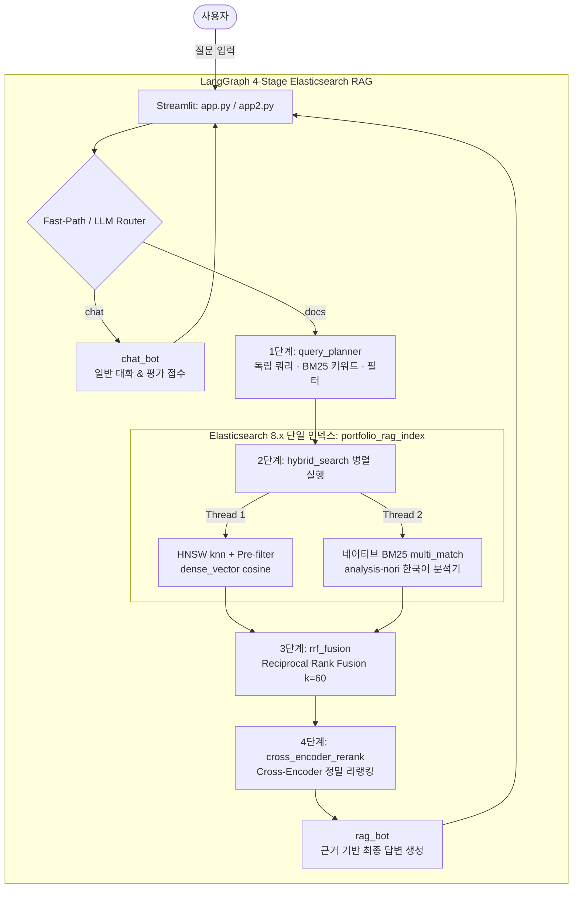

# 🔍 최규영 AI Portfolio Assistant (`cv_agent_elastic` - 실제 Elasticsearch 기반 4단계 하이브리드 RAG)

기존 `cv_agent_develop`(ChromaDB + 인메모리 Python BM25로 Elasticsearch 검색 방식을 유사 구현)을 **실제 Elasticsearch 8.x 엔진**으로 교체한 버전입니다.

단일 Elasticsearch 인덱스(`portfolio_rag_index`)에 **Dense Vector(`dense_vector` HNSW)** 와 **한국어 형태소 역색인(`analysis-nori` / 미설치 시 CJK Bigram 자동 폴백)** 을 함께 저장하고, 4단계 파이프라인(Query Planner ➔ ES HNSW kNN + ES BM25 병렬 검색 ➔ RRF ➔ Cross-Encoder 리랭킹)을 수행합니다.

---

## 🔄 `cv_agent_develop` vs `cv_agent_elastic` 비교

| 구분 | `cv_agent_develop` (유사 구현) | `cv_agent_elastic` (실제 Elasticsearch) |
| :--- | :--- | :--- |
| **저장소 구조** | ChromaDB(디스크) + Python `BM25Okapi`(메모리) 이원화 | **단일 Elasticsearch 인덱스(`portfolio_rag_index`)** 통합 관리 |
| **Dense 벡터 검색** | ChromaDB `similarity_search_by_vector` | **Elasticsearch HNSW `knn` + Pre-filter (`terms`/`term`)** |
| **Sparse BM25 검색** | Python 정규식 조사 제거 + `rank_bm25` | **Elasticsearch 네이티브 BM25 `multi_match` + `analysis-nori` 한국어 형태소 분석기** |
| **2단계 실행 방식** | 순차 실행 | **`ThreadPoolExecutor`로 ES kNN + ES BM25 실제 병렬 HTTP 요청** |
| **순위 통합 (3단계)** | Python RRF ($k=60$) | **ES kNN 순위 + ES BM25 순위 RRF ($k=60$)** (무료 Basic 라이선스 100% 호환) |
| **정밀 리랭킹 (4단계)** | Cross-Encoder + 한국어 교차 보정 | 동일 (`CrossEncoderReranker`) |

---

## 🏗 시스템 아키텍처



---

## 🚀 실행 방법

### 방법 1: Docker Compose로 Elasticsearch(Nori 포함) + 앱 한 번에 실행 (권장)

```bash
cd cv_agent_elastic
cp .env.example .env
# .env 파일에 GOOGLE_API_KEY 입력

docker compose up --build
```
- Elasticsearch (`analysis-nori` 사전 설치): `http://localhost:9200`
- Streamlit 웹 앱 (`app2.py` + `logger_api.py`): `http://localhost:8080`

### 방법 2: Elasticsearch만 Docker로 띄우고 로컬 Python으로 `app.py` 실행

```bash
cd cv_agent_elastic

# 1) Nori 플러그인이 포함된 Elasticsearch 8.15.3 실행
docker compose up -d --build elasticsearch

# 2) 패키지 설치
pip install -r requirements.txt

# 3) 사이드바에서 API 키 & Elasticsearch 설정을 직접 입력하는 app.py 실행
streamlit run app.py
```

### 방법 3: 기존 Elasticsearch / Elastic Cloud에 연결
- `app.py` 사이드바의 **🔍 Elasticsearch 연결 설정**에서 URL 또는 Elastic Cloud ID, API Key/Basic Auth를 입력하면 바로 연동됩니다.
- 클러스터에 `analysis-nori` 플러그인이 없으면 자동으로 `standard` + `cjk_width` + `cjk_bigram` 분석기로 폴백하여 오류 없이 인덱스를 생성합니다.

---

## 📋 Elasticsearch 인덱스 매핑 요약 (`portfolio_rag_index`)

- **한국어 분석기 (`korean_analyzer`)**:
  - `analysis-nori` 탐지 시: `nori_tokenizer` (`decompound_mode: mixed`) + `nori_readingform` + `lowercase` + `nori_part_of_speech`(조사/어미/기호 제거)
  - 미탐지 시: `standard` + `cjk_width` + `lowercase` + `cjk_bigram`
- **주요 필드**:
  - `chunk_id`, `source`, `category`: `keyword` (Exact Match & kNN Pre-filter용)
  - `doc_title`, `section`, `page_content`: `text` (`korean_analyzer`, BM25 `multi_match` 가중치 `section^2.5`, `doc_title^2.0`, `page_content^1.0`)
  - `embedding`: `dense_vector` (임베딩 모델 실제 차원 자동 감지, `similarity: cosine`, `hnsw` `m=16`, `ef_construction=100`)
